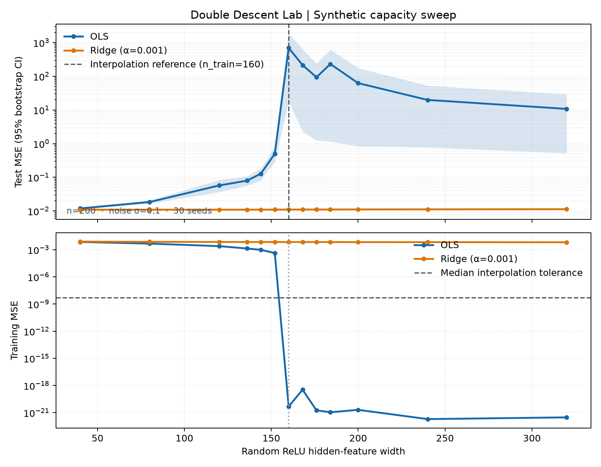
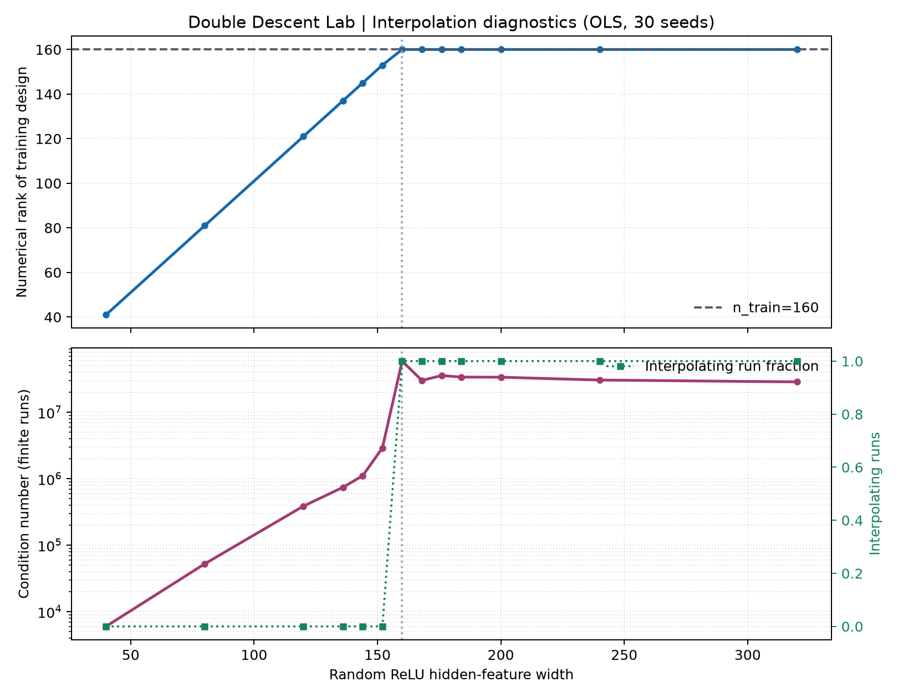
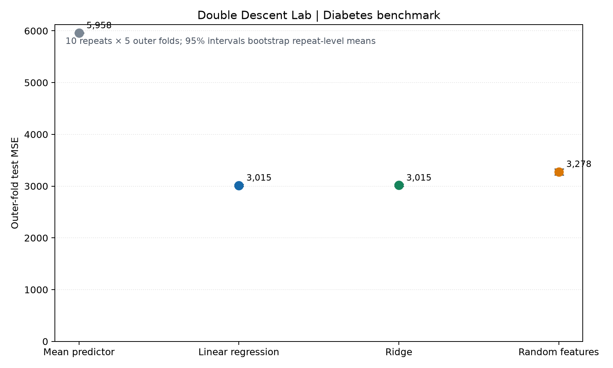

# Double Descent Lab
*A hands-on study of model capacity, noise, and regularization.*

[](https://github.com/MouradMgad/double-descent-lab/actions/workflows/ci.yml)
[](LICENSE)
[](https://www.python.org/)
[](https://numpy.org/)
[](https://scikit-learn.org/)

Double descent describes a possible pattern in which test error rises near the point where a model first interpolates its training data, then falls as capacity increases further. This reproducible Python research project studies that pattern in controlled random ReLU feature regression, checks how synthetic targets, input dimension, noise, and ridge regularization affect it, and compares the same model family with standard baselines on diabetes regression. The goal is to measure the effect carefully—not to claim it occurs universally.

**Start here:** inspect the results below, read the [research report](reports/research_report.md), or follow the [installation and reproduction steps](#install).

## Results at a glance



For this Phase 1 setting (`n=200`, noise `σ=0.1`), the repeated-seed OLS test-MSE curve peaks near the observed interpolation width and then declines; fixed-alpha ridge avoids the sharp peak. In the broader synthetic study, the run-level paired local peak criterion was met in all 14 tested target/dimension/noise conditions. These comparisons are exploratory and limited to the tested feature constructions and grid.

On the diabetes dataset, repeated nested cross-validation found that random features improved on the mean predictor but did **not** outperform Linear Regression or Ridge:

| Model | Mean test MSE | 95% repeated-CV interval |
|---|---:|---:|
| Mean predictor | 5,958 | 5,948–5,969 |
| Linear Regression | 3,015 | 2,995–3,036 |
| Ridge | 3,015 | 2,996–3,037 |
| Random features | 3,278 | 3,217–3,335 |

The intervals bootstrap the 10 repetition-level means. The paired random-feature-minus-Linear/Ridge MSE differences were +263 `[185, 333]` and +263 `[186, 335]`. See the [full research report](reports/research_report.md) for paired RMSE/MSE comparisons, methodology, uncertainty, and limitations.

## Research questions

- How does test error change as random-feature capacity crosses the measured interpolation region?
- How do target functions, observation noise, and input dimension affect the observed curve?
- How does ridge regularization change training interpolation and test error?
- Do the synthetic patterns imply better prediction on a real regression dataset?

## Methods and interpretation

The primary synthetic model is a random ReLU feature map with an OLS or ridge linear readout. In one dimension, random-sign slopes and empirical training-input quantile knots create a calibrated spline-like basis; in higher dimensions, the existing Gaussian weight and uniform bias initialization is used. The Phase 1 sweep compares capacities below and above training size over 30 seeds. The Phase 2 extension evaluates three synthetic targets, seven target/dimension combinations, and two noise levels, also over 30 seeds.

Interpolation is measured, not inferred from feature width: the saved results report SVD numerical rank and training MSE. The interpolation flag uses `train_mse <= 1e-10 + 1e-8 × Var(y_train)`. OLS uses SVD least squares; ridge uses augmented least squares without penalizing the intercept. The polynomial baseline compares raw monomials with Legendre features and documents numerical conditioning.

The primary real-data comparison loads scikit-learn's diabetes data with `scaled=False` and uses 10 repetitions of 5-fold outer cross-validation, with 5-fold inner selection. Mean prediction, Linear Regression, Ridge, and random features share identical outer folds. Scaling is fitted within each training fold; model selection uses only inner folds. The earlier Phase 2 five-split file is retained as a historical result, but the nested-CV results are the release benchmark because they avoid the dataset loader's pre-scaled features and provide paired model comparisons.

### Interpolation diagnostics



At 160 training rows, all 30 OLS runs at width 160 reached numerical rank 160 and met the interpolation tolerance. The report provides the seed-paired comparisons to adjacent capacities and explains why the peak evidence remains exploratory.

### Real-data benchmark



The diabetes benchmark shows a useful counterpoint to the controlled synthetic results: random features improve on the constant-mean baseline, but not on these linear baselines. This one-dataset experiment does not establish superiority or general real-world performance.

## Install

The workflow is configured for Python 3.12. Local validation for this release was run with Python 3.14.7; compatibility outside those versions is not claimed.

**Windows PowerShell**

```powershell
python -m venv .venv
.venv\Scripts\Activate.ps1
python -m pip install -r requirements-dev.txt
```

**macOS / Linux**

```bash
python3 -m venv .venv
source .venv/bin/activate
python -m pip install -r requirements-dev.txt
```

The diabetes dataset is provided by `sklearn.datasets.load_diabetes(scaled=False)`; no separate data download or committed dataset file is needed.

## Quick start

After installing the development dependencies, run the complete test suite and a fast benchmark check:

```powershell
python -m pytest -q
python src/diabetes_benchmark.py --smoke
```

GitHub Actions runs the same tests, checks dependency consistency, smoke-tests the benchmark, and verifies that the canonical figures can be rendered on each push to `main` and pull request. A manually triggered run is also available from the repository's **Actions** tab. The badge at the top of this page shows the latest workflow status.

## Reproduce

Run from the repository root. The full commands regenerate their phase-specific outputs; use a clean checkout or back up existing result files before rerunning them.

```powershell
# Complete Phase 1 repeated experiment and polynomial comparison
python src/experiment_runner.py --n-samples 200 500 1000 --noise-levels 0.1 0.5 --repetitions 30 --seed 42 --max-degree 40 --ridge-alpha 0.001

# Phase 2 synthetic robustness experiment and historical five-split evaluation
python src/phase2_runner.py

# Leakage-safe diabetes nested-CV benchmark and saved-run synthetic claim audit
python src/diabetes_benchmark.py

# Render the three curated figures from saved CSV outputs
python src/figure_assets.py

# Test code and dependency consistency
python -m pytest -q
python -m pip check
```

Phase 1 results and configuration are stored in `artifacts/`; Phase 2 results are in `artifacts/phase2/`; final nested-CV results, paired differences, and the synthetic audit are in `artifacts/final_release/`. The three canonical, README-ready images are in `assets/figures/`. The runners also preserve their phase-specific generated plots under `figures/`.

The benchmark entry point supports a quick, temporary smoke run that does not overwrite saved release results:

```powershell
python src/diabetes_benchmark.py --smoke
```

## Repository map

```text
.
├── .github/workflows/       # CI tests and smoke checks
├── artifacts/               # Frozen experiment CSVs and configurations
│   ├── phase2/
│   └── final_release/
├── assets/figures/          # Three curated figures used in documentation
├── data/README.md           # Dataset provenance; data comes from scikit-learn
├── figures/                 # Phase-runner output figures
├── LICENSE
├── reports/research_report.md
├── src/                     # Experiment, benchmark, and figure-generation code
├── tests/
├── requirements.txt
└── requirements-dev.txt
```

## Limitations

- The synthetic study covers a small, explicitly defined set of targets, dimensions, noise levels, sample size, and random-feature initializations.
- The peak capacity is selected from the same finite grid being assessed. Paired bootstrap comparisons to adjacent capacities are exploratory and are not corrected for post-selection or multiple comparisons.
- The calibrated one-dimensional feature map and higher-dimensional random initialization differ; results across dimensions are conditional on those constructions.
- The real-data comparison uses one small dataset. Repeated CV estimates variability across splits of that dataset, not across independent datasets.
- Double descent is not guaranteed for every model, dataset, or experimental design. These results do not show universal superiority of random-feature regression.
- Fixed seeds and configurations make runs reproducible, but small numeric or rendered-figure differences may occur across BLAS, operating-system, and library versions.

## Report, references, and license

Read the [research report](reports/research_report.md) for full tables, numerical diagnostics, configurations, and interpretation. Reproducibility settings are stored with the experiment outputs in `artifacts/experiment_config.json`, `artifacts/phase2/phase2_config.json`, and `artifacts/final_release/release_config.json`.

Background references are listed in the report. This repository is an experimental code and results release, not a published paper; no DOI or paper citation is claimed. The project code is released under the [MIT License](LICENSE). The bundled scikit-learn dataset remains subject to its upstream terms.

## Getting help or contributing

Use the repository's **Issues** tab to report a reproducible bug or suggest a research improvement. Include your Python version, the command you ran, and the complete error output. Before opening a pull request, run `python -m pytest -q`, `python -m pip check`, and the benchmark smoke test above. Keep claims tied to saved results and clearly describe any changes to experiment settings or interpretation.
